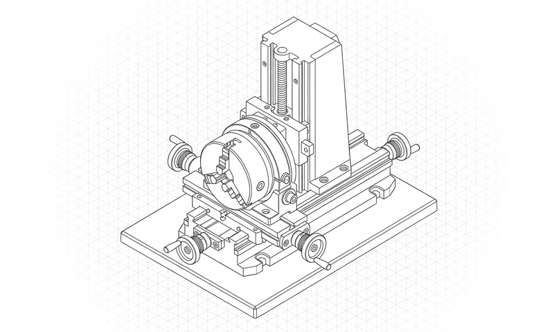

# DESIGN:OS 3D Blender Agent (`design-os-3d-blender`)

**Parametric 3D mechanical parts generator, headless Blender Python (`bpy`) pipeline, and embedded Three.js CAD showcase engine.**

Generate dimensionally accurate gears, enclosures, drone frames, and exploded mechanical assemblies from plain-English specs or JSON parameters, complete with glTF/STL exports and interactive browser inspection.

<<<<<<< HEAD
design-os-3d-blender is a free MCP server (Model Context Protocol, stdio) for Blender. Connect it to Claude Code, Codex, Cursor or any MCP client to model, render and verify parts in Blender 5.2 LTS. It is free, nothing is sold, and it is source-available under PolyForm Shield 1.0.0.

Agent skills, a verified bpy knowledge base, an `AGENT_OK` / `AGENT_FAIL` execution contract and a production gate for Blender 5.2 LTS. Every worked build below ships with what was checked and what was not.

[](LICENSE)
[](https://github.com/jangtrinh/design-os-3d-blender/commits/main)


[](https://github.com/ahujasid/blender-mcp)

[](https://aiagentslisting.com/mcp/design-os-3d-blender)
=======
<p align="center">
  
</p>

<p align="center">
  <a href="LICENSE"></a>
  
  <a href="commands/doctor.md"></a>
  <a href="https://jangtrinh.github.io/design-os-3d-blender/"></a>
  <a href="https://buymeacoffee.com/jangtrinh"></a>
</p>
>>>>>>> origin/main

<p align="center">
  <a href="#quickstart">Quickstart</a> · <a href="#what-it-makes">What it makes</a> · <a href="#installation">Install</a> · <a href="#how-it-works">How it works</a> · <a href="#commands--diagnostics">Commands</a> · <a href="#quality-bar--limitations">Limits</a>
</p>

---

## Why this exists

Text-to-3D diffusion models produce melted, non-manifold blobs that cannot be 3D-printed, machined, or cleanly animated in web viewers. **`design-os-3d-blender`** drives Blender's Python API (`bpy`) and Three.js deterministically to produce crisp mechanical geometry and interactive CAD showcases.

| Dimension | Generic AI / Manual Workflow | DESIGN:OS 3D Blender Agent (`DESIGN:OS`) |
| :--- | :--- | :--- |
| **Geometry Quality** | Melted AI diffusion meshes with non-manifold holes | Clean parametric `bpy` booleans, bevels, and precision vertex topology |
| **Dimensional Accuracy** | Arbitrary unscaled units that fail in slicers | Millimeter-locked parametric dimensions and bounding-box verification |
| **Web Inspection** | Static screenshots with no way to inspect hidden faces | Embedded Three.js CAD viewer with orbit controls, wireframe, and exploded scrub |
| **Reproducibility** | Unrepeatable random seeds | Git-tracked Python generator scripts and declarative JSON part specs |
| **Privacy & Telemetry** | Opaque cloud telemetry or unverified third-party APIs | **Zero telemetry** — 100% local execution ([`PRIVACY.md`](PRIVACY.md) audited) |

---

## Quickstart

### 1. Install the plugin or CLI

**In Claude Code:**

```text
/plugin marketplace add jangtrinh/design-os-3d-blender
/plugin install design-os-3d-blender@design-os-3d-blender
```

**Or from your terminal (Codex, Gemini CLI, Antigravity, OpenCode, or standalone CLI):**

```bash
git clone https://github.com/jangtrinh/design-os-3d-blender.git
cd design-os-3d-blender
python3 scripts/self_check.py
```

### 2. Ask in plain English

Open your project in your AI coding agent and describe what you need:

> "Generate a parametric 24-tooth helical gear and mounting bracket in headless Blender and export glTF + STL artifacts."

> "Build an interactive Three.js CAD viewer page with exploded-view scrubbing, wireframe toggle, and orthographic camera presets."

> "Audit the exported mesh topology for non-manifold edges, zero-area faces, and bounding-box dimensional tolerances."

### 3. Verify your setup

```bash
python3 scripts/self_check.py
```

---

## What it makes

Every deliverable produced by `design-os-3d-blender` is backed by a deterministic verification gate rather than freehand AI guesswork.

<p align="center">
  <br>
  <sub>Prompt: <code>"Generate a parametric 24-tooth helical gear and mounting bracket in headless Blender and export glTF + STL artifacts."</code></sub>
</p>

| Deliverable / Mode | Best for | Output Format | Verification Gate |
| :--- | :--- | :--- | :--- |
| **Parametric `bpy` Part Scripts** | Reproducible headless Blender generation for brackets, gears, and housings | `Python (.py) + JSON spec` | `Zero non-manifold edges` |
| **Print & Web 3D Assets** | Exporting production meshes for 3D printing and real-time web rendering | `.glb / .gltf / .stl / .obj` | `Bounding-box & file integrity check` |
| **Three.js CAD Showcase** | Interactive browser viewer with material switches and exploded assembly scrub | `Self-contained HTML + Three.js` | `60fps WebGL render check` |

---

## Installation

Choose the setup that matches your AI coding agent. Every option installs the same canonical skill (`skills/design-os-3d-blender/SKILL.md`) and `/doctor` diagnostic suite.

### Claude Code

Run these two commands inside Claude Code:

```text
/plugin marketplace add jangtrinh/design-os-3d-blender
/plugin install design-os-3d-blender@design-os-3d-blender
```

### OpenAI Codex

Install to your personal Codex skills directory:

```bash
git clone https://github.com/jangtrinh/design-os-3d-blender.git /tmp/design-os-3d-blender
mkdir -p ~/.codex/skills/design-os-3d-blender ~/.codex/prompts
cp -R /tmp/design-os-3d-blender/skills/design-os-3d-blender/* ~/.codex/skills/design-os-3d-blender/
cp /tmp/design-os-3d-blender/prompts/doctor.md ~/.codex/prompts/design-os-3d-blender-doctor.md
rm -rf /tmp/design-os-3d-blender
```

### Gemini CLI & Google Antigravity

```bash
git clone https://github.com/jangtrinh/design-os-3d-blender.git /tmp/design-os-3d-blender
mkdir -p ~/.gemini/skills/design-os-3d-blender
cp -R /tmp/design-os-3d-blender/skills/design-os-3d-blender/* ~/.gemini/skills/design-os-3d-blender/
rm -rf /tmp/design-os-3d-blender
```

### OpenCode, Cursor, Windsurf & Other Agent Harnesses

```bash
git clone https://github.com/jangtrinh/design-os-3d-blender.git /tmp/design-os-3d-blender
mkdir -p ~/.agents/skills/design-os-3d-blender
cp -R /tmp/design-os-3d-blender/skills/design-os-3d-blender/* ~/.agents/skills/design-os-3d-blender/
rm -rf /tmp/design-os-3d-blender
```

<details>
<summary>Verify or uninstall</summary>

**Verify installation:**

```bash
python3 scripts/self_check.py
```

Or run `/doctor` inside Claude Code / Codex to inspect installed skill paths, plugin manifests, and gate health.

**Uninstall:**

```bash
rm -rf ~/.claude/skills/design-os-3d-blender ~/.codex/skills/design-os-3d-blender ~/.gemini/skills/design-os-3d-blender ~/.agents/skills/design-os-3d-blender
```

</details>

---

## Usage & Prompt Cookbook

Once installed, `skills/design-os-3d-blender/SKILL.md` activates automatically when your prompt matches its domain triggers. Browse [`docs/cookbook.md`](docs/cookbook.md) for copy-paste prompt recipes.

**Generate & Scaffold**

```text
"Generate a parametric 24-tooth helical gear and mounting bracket in headless Blender and export glTF + STL artifacts."
```

**Audit & Verify**

```text
"Build an interactive Three.js CAD viewer page with exploded-view scrubbing, wireframe toggle, and orthographic camera presets."
```

**Export & Automate**

```text
"Audit the exported mesh topology for non-manifold edges, zero-area faces, and bounding-box dimensional tolerances."
```

---

## Commands & Diagnostics

| Command | Environment | What it does |
| :--- | :--- | :--- |
| `/doctor` | Claude Code / Codex | Read-only diagnostic check of installed skill paths, plugin manifests, and runtime prerequisites |
| `python3 scripts/self_check.py` | Terminal / CI | Deterministic offline verification of manifests, skill contracts, and governance files |
| `python3 scripts/self_check.py` | Terminal / CI | Verify 3D Blender skill contracts, CAD showcase assets, and repository delivery manifests |

---

## How it works

1. **Intent Routing** — Your AI agent matches your request against `skills/design-os-3d-blender/SKILL.md` frontmatter triggers.
2. **Progressive Context Loading** — Only the entry-point `SKILL.md` router loads initially; detailed recipes and scripts load on demand.
3. **Deterministic Execution** — Domain scripts and contracts execute locally with reproducible inputs and outputs.
4. **Gate Verification** — `scripts/self_check.py` and domain verifiers (`python3 scripts/self_check.py`) validate the artifact before completion.
5. **Zero-Telemetry Delivery** — Verified files are written directly to your workspace with zero external network calls.

```text
User Prompt / CLI Invocation
            │
            ▼
┌───────────────────────────────────────────────┐
│ skills/design-os-3d-blender/SKILL.md
│ Progressive disclosure router & hard rules    │
└───────────┬───────────────────────────────────┘
            │ loads on demand
            ▼
┌───────────────────────────────────────────────┐
│ python3 scripts/self_check.py
│ Deterministic build & contract enforcement    │
└───────────┬───────────────────────────────────┘
            │ verifies
            ▼
┌───────────────────────────────────────────────┐
│ python3 scripts/self_check.py + /doctor       │
│ Zero-telemetry local verification gate        │
└───────────────────────────────────────────────┘
```

### What loads when

`design-os-3d-blender` uses progressive context disclosure so your agent's context window stays fast and focused:

| File | Loaded when |
| :--- | :--- |
| `skills/design-os-3d-blender/SKILL.md` | Always (~100–150 lines) — routing rules, triggers, and execution workflow |
| `docs/cookbook.md` | When selecting multi-step prompt recipes or domain patterns |
| `commands/doctor.md` / `prompts/doctor.md` | Only when running `/doctor` diagnostics |
| `llms.txt` | When indexed by AI answer engines, RAG pipelines, or repo crawlers |

---

## File structure

```text
design-os-3d-blender/
├── .claude-plugin/
│   ├── plugin.json                 # Claude Code plugin manifest
│   └── marketplace.json            # Claude Code marketplace catalog
├── .codex-plugin/
│   └── plugin.json                 # OpenAI Codex plugin & interface manifest
├── .agents/
│   └── plugins/marketplace.json    # Cross-agent local plugin registry
├── .factory-plugin/
│   ├── plugin.json                 # Factory / Droid plugin manifest
│   └── marketplace.json            # Factory marketplace metadata
├── skills/
│   └── design-os-3d-blender/
│       └── SKILL.md                # Canonical agent skill entrypoint
├── commands/
│   └── doctor.md                   # /doctor diagnostic slash command
├── prompts/
│   └── doctor.md                   # Codex diagnostic prompt mirror
├── scripts/
│   └── self_check.py               # Deterministic repository & skill self-check
├── docs/
│   ├── cookbook.md                 # Copy-paste prompt recipes by job
│   └── llms.txt                    # GEO / LLM discovery index
├── PRIVACY.md                      # Zero-telemetry & local-first privacy commitment
├── SECURITY.md                     # Vulnerability disclosure & security policy
├── CONTRIBUTING.md                 # Contribution workflow & verification rules
├── CODE_OF_CONDUCT.md              # Contributor Covenant code of conduct
├── CHANGELOG.md                    # Release history
├── llms.txt                        # Root LLM indexing manifest
├── LICENSE                         # PolyForm Shield 1.0.0
└── README.md
```

---

## Quality bar & Limitations

### It's working if...

- `python3 scripts/self_check.py` prints `ok: design-os-3d-blender self-check passed (design-os-3d-blender)` and exits `0`.
- `python3 scripts/self_check.py` passes with zero contract or test regressions.
- Your AI coding agent loads `skills/design-os-3d-blender/SKILL.md` automatically when given any prompt from [`docs/cookbook.md`](docs/cookbook.md).
- Network traffic during execution remains zero (guaranteed by [`PRIVACY.md`](PRIVACY.md)).

### When not to use

- Sheet-metal or paperboard folding dielines where 2D crease patterns govern topology (use `design-os-origami`).
- Organic character sculpting or AAA rigged game characters requiring manual ZBrush artistry.
- 2D vector UI motion walkthroughs (use `design-os-svg-animation`).

---

## DESIGN:OS Ecosystem

`design-os-3d-blender` is one of the 13 source-available engines in the **`DESIGN:OS`** ecosystem:

| Engine | Live Docs | Repository | Layer |
| :--- | :--- | :--- | :--- |
| **DESIGN:OS CLI** | [jangtrinh.github.io/design-os](https://jangtrinh.github.io/design-os/) | [`jangtrinh/design-os`](https://github.com/jangtrinh/design-os) | `cli` |
| **Knowledge Builder** | [jangtrinh.github.io/design-os-knowledge-builder](https://jangtrinh.github.io/design-os-knowledge-builder/) | [`jangtrinh/design-os-knowledge-builder`](https://github.com/jangtrinh/design-os-knowledge-builder) | `compiler` |
| **Figma Plugin & CLI** | [jangtrinh.github.io/design-os-figma-plugin](https://jangtrinh.github.io/design-os-figma-plugin/) | [`jangtrinh/design-os-figma-plugin`](https://github.com/jangtrinh/design-os-figma-plugin) | `plugin` |
| **SVG Animation Engine** | [jangtrinh.github.io/design-os-svg-animation](https://jangtrinh.github.io/design-os-svg-animation/) | [`jangtrinh/design-os-svg-animation`](https://github.com/jangtrinh/design-os-svg-animation) | `engine` |
| **3D Blender Agent** | [jangtrinh.github.io/design-os-3d-blender](https://jangtrinh.github.io/design-os-3d-blender/) | [`jangtrinh/design-os-3d-blender`](https://github.com/jangtrinh/design-os-3d-blender) | `3d / cad` |
| **OPAH ONE Drone** | [jangtrinh.github.io/design-os-drone-showcase](https://jangtrinh.github.io/design-os-drone-showcase/) | [`jangtrinh/design-os-drone-showcase`](https://github.com/jangtrinh/design-os-drone-showcase) | `hardware` |
| **GitHub Pages Engine** | [jangtrinh.github.io/design-os-github-page](https://jangtrinh.github.io/design-os-github-page/) | [`jangtrinh/design-os-github-page`](https://github.com/jangtrinh/design-os-github-page) | `pages` |
| **Apple Design OS** | [jangtrinh.github.io/design-os-apple](https://jangtrinh.github.io/design-os-apple/) | [`jangtrinh/design-os-apple`](https://github.com/jangtrinh/design-os-apple) | `swiftui` |
| **Agent Teacher** | [jangtrinh.github.io/design-os-pedagogy](https://jangtrinh.github.io/design-os-pedagogy/) | [`jangtrinh/design-os-pedagogy`](https://github.com/jangtrinh/design-os-pedagogy) | `pedagogy` |
| **Origami CAD** | [jangtrinh.github.io/design-os-origami](https://jangtrinh.github.io/design-os-origami/) | [`jangtrinh/design-os-origami`](https://github.com/jangtrinh/design-os-origami) | `packaging` |
| **Voice UX Architecture** | [jangtrinh.github.io/design-os-voice-ux](https://jangtrinh.github.io/design-os-voice-ux/) | [`jangtrinh/design-os-voice-ux`](https://github.com/jangtrinh/design-os-voice-ux) | `voice-ai` |
| **Code2Flow** | [jangtrinh.github.io/design-os-code2flow](https://jangtrinh.github.io/design-os-code2flow/) | [`jangtrinh/design-os-code2flow`](https://github.com/jangtrinh/design-os-code2flow) | `ast / audit` |
| **Generative UI** | [jangtrinh.github.io/design-os-generative-ui](https://jangtrinh.github.io/design-os-generative-ui/) | [`jangtrinh/design-os-generative-ui`](https://github.com/jangtrinh/design-os-generative-ui) | `runtime` |

---

## Contributing, Governance & License

- **Contributing**: See [`CONTRIBUTING.md`](CONTRIBUTING.md) for pull request guidelines and verification gates (`python3 scripts/self_check.py`).
- **Code of Conduct**: Governed by [`CODE_OF_CONDUCT.md`](CODE_OF_CONDUCT.md).
- **Security & Privacy**: Zero telemetry — see [`SECURITY.md`](SECURITY.md) and [`PRIVACY.md`](PRIVACY.md).
- **Changelog & LLM Index**: Track releases in [`CHANGELOG.md`](CHANGELOG.md) and machine-readable index in [`llms.txt`](llms.txt).
- **License**: [PolyForm Shield 1.0.0](LICENSE) © [Jang Trinh](https://github.com/jangtrinh). Free to use and modify, including for paid client work; you may not resell it or build a competing product from it.

---

If `design-os-3d-blender` saves you time, a star on GitHub helps other engineers and AI agents find it.

<<<<<<< HEAD
| Build | Demonstrated | Still separate |
|---|---|---|
| Robot arm | Native assembly film, sampled motion checks, exported fit prototypes and a 38-part digital gate report. | Loaded operation, hardware retention, thermal duty and physical assembly qualification. |
| Watch winder | Native stills, sampled motion checks, digital print-kit checks and fit visualization. | Actual printing, physical fit and manufacturing qualification. |
| DC-01 desktop companion | Eighteen printable parts through the geometry gate with STL round-trip and independent 3MF reopening, 26 of 26 harness connections, a KiCad carrier with zero ERC/DRC violations, and a 39-second native animatic. | Printing and process trials, switch actuation, battery charge window, electronics and firmware, and every physical assembly and thermal test. |
| CK-001 keyboard | Reference-bound 58-key digital prototype: modeled receivers, guides and D couplings, sampled key travel, form/final gates on eight part families, GLB round-trip of 781 meshes, native Full HD media. | Switch retention, tolerance extremes, electronics and firmware, process trials and bench/load/thermal qualification. |
| ORC components | Reference-driven component development, reusable parts and revision-specific image/geometry checks. | Selected equipment, complete plant integration, process duty and fabrication qualification. |

The worked-build READMEs carry the detailed receipts and exclusions. The knowledge catalogue also includes small execution examples; the full private ORC development history and the source reference images are not shipped.

## What the builds taught us

Both full product builds converged on one loop — build → numeric assert ending in the sentinel → immutable run directory → an independent re-open of the saved artifact → a named review report → freeze by SHA — and the incidents that cost the most are recorded with their evidence files:

1. **Specify the construction.** A wheel, cabinet or gauge name is an inventory item; a brief needs profile, thickness, transitions, layers, mounting and a visible condition that would reject the result.
2. **Model and gate the mating interface before any presentation work.** Missing receivers cost a whole revision of a finished-looking keyboard.
3. **A sampled predicate is not a bound.** Re-check at the exact extremes and both sides of every join: 3.198 mm sampled, 2.9964 mm true.
4. **Motion belongs in the media contract.** A film that renders 120 poses at 5 poses per second passes every gate and still fails the owner.
5. **Verify the artifact and the verifier.** A surprising measurement gets a disproving probe before any geometry changes; qualify a renderer by pixel identity, never by speed.
6. **Bind delivery to the actual revision.** Freeze source, camera and settings, keep old media under its own identity, and record manual checks separately from automated gates.

Read [the two-build distillation](docs/native-build-pipeline-lessons.md), the [CK-001 retrospective](docs/ck-001-session-retrospective.md), the [ORC component lessons](docs/orc-session-lessons.md) with their [public journal](docs/journals/orc-component-reconstruction.md), and start a new project from the [product workflow template](docs/product-workflow-template.md). Specialised reading: [geometry diagnosis](knowledge/60-pipeline/geometry-diagnostic-workflow.md), [native media delivery](knowledge/60-pipeline/native-render-delivery.md), [manufacturing evidence](knowledge/60-pipeline/manufacturing-evidence-workflow.md), [publishing a review page](docs/delivery-review-publication.md).

The [C03/E02 source package](builds/reference-keyboard/manufacturing/README.md) adds full-stroke cap clearance, mechanical retention, acrylic collars, corrected LED polarity and an explicitly incomplete physical pilot ledger. The public Revision-B gallery remains historical media for B, not an approval of C03.

## License

Source-available under [PolyForm Shield 1.0.0](LICENSE) © [Jang Trinh](https://github.com/jangtrinh). Free to use and modify, including for paid work; you cannot resell it or build a competing product with it. Vendored dependencies retain their own licenses.
=======
<p align="left">
  <a href="https://buymeacoffee.com/jangtrinh">
    
  </a>
</p>
>>>>>>> origin/main
