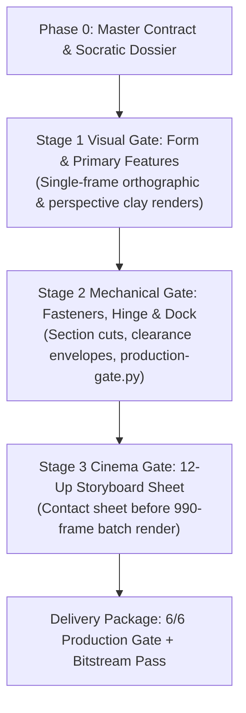

# MC-RB5320 Session Retrospective: Zero-Screw FDM Enclosure & 12-Shot Product Film

Session: 11 November 2026. This retrospective distills the lessons, architectural patterns,
and falsifiers from the `MC-RB5320-R03` build (Mochi-Soul Desktop Companion Housing and
its accompanying 36.0-second 12-shot Cycles 3D Product Film) into reusable engineering assets
for the `design-os-3d-blender` foundation.

---

## 1. What is Now Reusable

| Intent | Procedure / Asset | Target Location |
|---|---|---|
| Detect dropped shaders & blackout frames in sequences | Inter-frame $\Delta L_{\text{avg}}$ and channel floor audit | `scripts/check-sequence-continuity.py` |
| Resume interrupted or corrupted frame ranges (`E4`) | Target-bound surgical rerun JSON emission | `scripts/check-sequence-continuity.py --emit-rerun-json` |
| Build pure FDM zero-screw enclosure joints | Top hook-hinge and cantilever snap-lock generators | `scripts/boilerplates/dfam_3dprint/bp_enclosure_joints.py` |
| Design acoustic/thermal grilles without knife-edge walls | Concentric radial & hexagonal perforation cutters | `scripts/boilerplates/dfam_3dprint/bp_parametric_perforations.py` |
| Verify video bitstreams & distinct decoded states | ffprobe stream audit + `ffmpeg -f framemd5` check | `scripts/verify-video-bitstream.py` |
| Sanitize PNG/WebP metadata & workstation paths | Chunk stripper + JSON repo-relative path rewriter | `scripts/sanitize-delivery-assets.py` |
| Chunked Visual Decision Gates | 3-stage visual gate before GPU-heavy batch renders | `.agents/skills/blender-agent-core/SKILL.md` |

---

## 2. Key Incidents & Falsifiers

### Incident 1: Cycles Metal `use_persistent_data = True` Blackout Drops
- **Symptom**: During a 990-frame batch render across 11 camera sequences, 210 intermediate frames
  (`seq-04`, `seq-09 [20..22, 60..80]`, `seq-10 [75..80]`, `seq-12 [40, 83..89]`) silently dropped
  the `ShaderNodeBevel` metallic housing material, rendering pitch-black silhouettes.
- **Root Cause**: `scene.render.use_persistent_data = True` kept internal Metal scene representations
  stale across dynamic in-memory object visibility changes and camera cuts.
- **Falsifier & Fix**: Verified with `scripts/check-sequence-continuity.py`. Setting
  `scene.render.use_persistent_data = False` permanently eliminated the shader drop. Surgical re-rendering
  of the 210 frames completed in 4.2 minutes rather than re-rendering the full 990 frames.

### Incident 2: Headless Chrome Seek-Capture `mjpeg` Gamma Shifts
- **Symptom**: The exported MP4 displayed elevated blacks and washed-out contrast in QuickTime and Safari,
  failing ROB-AD §7 video compliance checks.
- **Root Cause**: The Puppeteer `seek-capture` bridge streamed frames via MJPEG pipes that default to `yuvj420p`
  (`pc` full-range 0–255) rather than standard broadcast `tv` limited-range (16–235).
- **Falsifier & Fix**: Re-encoded using:
  `-vf "scale=in_range=pc:out_range=tv,format=yuv420p" -color_range tv -colorspace bt709`
  Verified with `scripts/verify-video-bitstream.py`.

### Incident 3: Mid-Film Fade Blackouts and Paused Poster Degradation
- **Symptom**: Fading to black between narrative beats caused video player pause states and scrubbing
  to show empty black frames.
- **Fix**: Replaced black-dip transitions with cinema hard-cuts on motion and a photo-to-3D match-cut
  cross-dissolve. Held the final spec card for 1.0 s ($L \ge 15.0$) so paused playback presents a clean poster.

### Incident 4: Downstream CI Failures on Exported Assets
- **Symptom**: Merging the housing and film assets into `design-os-robotics` failed GitHub Actions on:
  - Gate `S-13 (image-pii)`: Blender automatically wrote `tEXtSoftware\0Blender 5.2.0` into PNG headers.
  - Gate `S-02 (path hygiene)`: Audit receipts contained `/Users/jangtrinh/...` absolute paths.
- **Fix**: Built `scripts/sanitize-delivery-assets.py` to strip metadata chunks from images and relativize
  paths in JSON receipts while preserving all SHA-256 integrity hashes.

---

## 3. The 3-Stage Chunked Visual Decision Gate

To prevent expensive throwaway work, every product build follows this phased review ladder:

1. **Stage 1 (Form Gate)**: Before designing internal clips or cavities, present clay orthographic and
   perspective renders to the owner. (In MC-RB5320, this gate caught the plain front face and led directly
   to adding the Apple-style 132-hole acoustic grille).
2. **Stage 2 (Mechanical Gate)**: Validate mating hook-hinges, button living hinges, and cable pass-throughs
   with `scripts/production-gate.py` exit 0 before authoring camera motion.
3. **Stage 3 (Cinema Gate)**: Render a 12-up storyboard contact sheet with key beat poses. Long sequence renders
   only start once the owner approves the storyboard.
